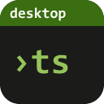

# testing-desktop

A local web UI for the test and CI results of the repositories that use
[testing.nvim](https://github.com/WKDSteve/testing.nvim): every repository at a glance (the last local run, the last CI
run on each operating system, the red cases with their output), in the browser first and as a small native app
after that. The sibling of [tasks-desktop](https://github.com/WKDSteve/tasks-desktop) and
[rules-desktop](https://github.com/WKDSteve/rules-desktop), built on the same parts and meant to look and behave like
them. Its web variant, one HTML file opened from disk, is published to
[testing-web](https://github.com/WKDSteve/testing-web).

**Status: early development. No release yet.** The hub starts, pairs a browser, passes the security matrix of
[appkit](https://github.com/WKDSteve/appkit) and reads the fleet, one repository and its findings from testing.nvim
(`/api/testing/fleet`, `/api/testing/repo?key=...`, `/api/testing/finding?key=...`, with the digest of the document as
the ETag). The fleet is a snapshot: a watcher of the state folder renews it, one question to the engine per change, and
`/api/testing/events` tells the page. The page shows the fleet (the last local run and the CI on each system, red first,
a filter for the red ones and a search) and one repository with its red cases, their output, its findings and the history of its runs, and follows new results
by itself. With a GitHub token (a file, or the login of `gh`) the CI columns show the state of GitHub, asked at most once a minute per repository; without one they say "not asked". The phases below fill it. CI, the rolling build `latest`, the release workflow and the install scripts are
there ([docs/USAGE.md](docs/USAGE.md), [docs/SECURITY.md](docs/SECURITY.md), [docs/RELEASING.md](docs/RELEASING.md)).

## Principles

- **The engine is the only source.** testing.nvim writes every result. The app reads its versioned documents
  (`testing-export/1`) and never parses a state file of its own.
- **Read only.** The hub starts no test run in this phase and writes into no repository.
- **Loopback only, token always.** Host and Origin are checked, there is no data endpoint without a session.
- **Data classes fail closed.** The hub reads the export form of the engine: no absolute path, and only the
  repositories the data classes of the device release.
- testing.nvim stays a pure Lua plugin. This repository holds the hub, the UI and later the native shell.

## Plan

| Phase | What |
| --- | --- |
| scaffold | the hub on appkit: names, settings, guard and security tests, no data route |
| engine | the engine seam to testing.nvim and the routes of the fleet, a repository and its findings |
| ui-read | the read-only interface: overview, filter "red", detail with the red cases, link to the CI run |
| release | CI, the rolling build, releases and the install scripts |
| web | the same interface as `testing.html` for `file://`, reading an export folder: built (`pnpm web:build`), not published yet |
| later | history of runs, starting a run through the engine, a panel in the central hub |

The planning notes live outside this repository, in the maintainer's task vault.

## Layout

```
crates/testing-hub/   the hub: names, settings, the engine seam to testing.nvim, routes, on appkit
engine.lock           the testing.nvim and lib.nvim commits this is built and tested against
ui/                   the page (Svelte 5, Vite, TypeScript, appkit-ui), read through a source of its own (`TestingSource`)
ui/src/web/           the web variant: the export folder as a source, its check against the contract, the way in
ui/web/               the packing into one file and the tests of the web variant
ui/e2e/               browser tests (Playwright, axe) against the real binary, the real engine and repositories made for them
ui/e2e-web/           browser tests of the single file, opened from disk
tools/                checks of the repository (appkit pin, lock age, control characters, colours, temp leftovers)
scripts/              build and install from a checkout, uninstall, the tests of both
docs/                 usage, security of the server, releasing
.github/workflows/    ci, rolling (`latest` after a green CI), release (a tag makes a draft), on a self-hosted Windows runner
```

## Running the hub

The program is `testing-hub`; its verbs are those of `tasks-hub` and `rules-hub`:

```
testing-hub serve [--port N]      run the hub until Ctrl-C
testing-hub start [--open]        run it in the background (log in the config folder)
testing-hub stop                  stop that hub
testing-hub open [--launch]       print (or open) a one-time pairing link
testing-hub autostart on|off|status
testing-hub install [--autostart] [--shortcut]
testing-hub uninstall [--purge-settings]
```

The config folder is `%APPDATA%\testing-desktop` (`~/.config/testing-desktop`; `TESTING_DESKTOP_CONFIG_DIR` moves it).
The default port is 17618 (`TESTING_DESKTOP_PORT`, or `port` in `config.json`).

It needs a Neovim (0.12 or newer) and a testing.nvim checkout: `TESTING_NVIM` (else the one on the `PATH`) and
`TESTING_ENGINE_DIR` (else `$REPOS_DIR/testing.nvim`), or the keys `nvim` and `engine_dir` of `config.json`. The
repositories it shows are those below `vault` of `config.json`, else `TESTING_REPOS_ROOT`, else `REPOS_DIR`.

The engine runs as a child with only a few variables of the environment, so the hub tells it where to read:

- `state_dir` (or `TESTING_DESKTOP_STATE_DIR`): the state folder of testing.nvim, `stdpath('state')` of the Neovim
  that runs the tests; by default `%LOCALAPPDATA%\nvim-data` (`$XDG_STATE_HOME/nvim` or `~/.local/state/nvim`;
  `NVIM_APPNAME` is followed).
- `areas` (or `TESTING_DESKTOP_AREAS`): the `areas.json` of the data classes of this device; by default the one of
  tasks-desktop (`%APPDATA%\tasks-desktop\areas.json`). Only the `public` and `internal` repositories it names are
  shown; without the file none is.

A `config.json` that cannot be read, or a path in it or in one of these variables that is not whole, stops the start.
`about` says where each came from (`environment`, `setting`, `default`), never the path.

## Building and checking

Rust (the version in `Cargo.toml`), Node with pnpm, and Python 3. The page is built first: the hub embeds `ui/dist`
when it is built (without it, the placeholder page of the kit).

```
cd ui && pnpm install --frozen-lockfile && pnpm check && pnpm test && pnpm build && cd ..
cargo fmt --all --check
cargo clippy --workspace --all-targets --locked -- -D warnings
cargo test --workspace --locked
python -m unittest discover -s tools -p "test_*.py"
python tools/check-control-chars.py
python tools/check-lock-age.py --min-days 7
cd ui && pnpm e2e        # after `cargo build`: the binary must hold the page that was built
```

The tests that use the real engine find testing.nvim in `TESTING_ENGINE_DIR`, else `$REPOS_DIR/testing.nvim`; with
`TESTING_HUB_REQUIRE_ENGINE=1` a missing engine is a failure, not a skip. The browser tests take a free port for each
run (`TESTING_E2E_PORT` names one).

## The shared kit

The server guard, sessions, pairing, limits and the login entry come from [appkit](https://github.com/WKDSteve/appkit),
pinned by its tag in `Cargo.toml`; `Cargo.lock` pins the commit.

## License

MIT, see [LICENSE](LICENSE).
